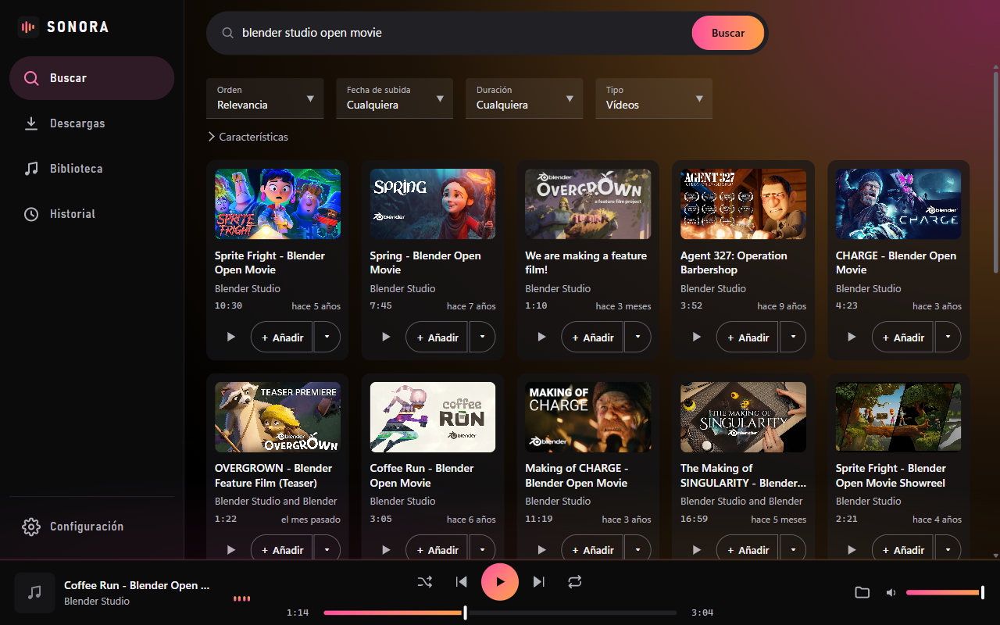

<p align="center">
  
</p>

<h1 align="center">Sonora</h1>

<p align="center">
  Busca música en YouTube, descárgala en MP3 de alta calidad y escúchala desde tu propia biblioteca.<br>
  Una app de escritorio para Windows que se abre sin instalar nada.
</p>

<p align="center">
  <a href="https://github.com/Johan-ux/Sonora/releases/latest"></a>
  <a href="https://github.com/Johan-ux/Sonora/actions/workflows/ci.yml"></a>
  <a href="LICENSE"></a>
  
  
</p>

<p align="center">
  <a href="https://github.com/Johan-ux/Sonora/releases/latest/download/Sonora-windows-x64.zip"><b>⬇️ Descargar para Windows</b></a>
  ·
  <a href="docs/uso.md">Guía de uso</a>
  ·
  <a href="CHANGELOG.md">Novedades</a>
</p>

<p align="center">
  
</p>

---

## Empezar

1. Descarga [`Sonora-windows-x64.zip`](https://github.com/Johan-ux/Sonora/releases/latest/download/Sonora-windows-x64.zip)
   de la última versión.
2. Descomprímelo (clic derecho → *Extraer todo*).
3. Abre `Sonora\Sonora.exe`.

Lleva dentro todo lo que necesita (ffmpeg y el runtime de JavaScript), y yt-dlp
se actualiza desde la propia app. Funciona en Windows 10 y 11 de 64 bits.

> Al ser un `.exe` sin firmar, la primera vez Windows puede decir «Windows
> protegió su PC»: **Más información → Ejecutar de todas formas**. Si quieres
> comprobar la descarga, cada versión publica la huella SHA-256 del zip.

## Funciones

- 🔎 **Buscador integrado**: busca por canción o artista, o pega una URL de
  vídeo, **playlist**, **canal** o **Mix** de YouTube. Con **filtros** como
  los de YouTube: orden (también por más recientes), fecha de subida,
  duración, tipo y características (4K, HD, subtítulos…).
- 👂 **Vista previa**: escucha o mira un resultado antes de decidir si lo
  descargas.
- 📥 **Cola persistente**: sobrevive al reinicio. Elige carpeta de destino y
  calidad; las preferencias **se recuerdan**.
- 🚦 **Descargas bajo control**: progreso en vivo por canción, varias a la vez,
  **cancelar** la que está en curso, **reintentar** las fallidas (una a una o
  todas), lotes plegables para playlists grandes y aviso de duplicados.
- 🎵 **MP3 de calidad**: de 128 a **320 kbps**, con **carátula** y
  **metadatos** incrustados. También vídeo en MP4, hasta 4K.
- 📚 **Biblioteca**: explora por carpetas y filtra al instante, rápida incluso
  con cientos de canciones.
- ▶️ **Reproductor**: aleatorio, **repetir (lista/pista)**, volumen que se
  recuerda, teclas multimedia del sistema y atajos de teclado.
- 🎬 **Vídeo**: una ventana flotante que se mueve y se redimensiona a mano, con
  modo teatro y pantalla completa.
- 🎨 **Nueve temas de color** sobre una interfaz negra.
- ♿ **Accesible**: navegación por teclado completa, foco visible, lectores de
  pantalla, contraste AA y respeto de «reducir movimiento».
- 🖥️ **CLI incluida**: descarga por lotes desde la terminal con
  `python -m sonora.cli urls.txt`.

## Sistemas

|                                     | Windows 10 y 11 | macOS                  | Linux          |
| ----------------------------------- | :-------------: | :--------------------: | :------------: |
| Ejecutable listo para abrir         | ✅              | —                      | —              |
| Desde el código                     | ✅ Ventana propia | 🧪 Ventana propia, sin probar | ✅ En el navegador |
| Se comprueba en cada cambio (CI)    | ✅              | —                      | ✅             |

- **Windows** es donde se desarrolla y se prueba todo, y el único sistema con
  ejecutable: PyInstaller solo construye el del sistema en el que se ejecuta, y
  el de Sonora lleva dentro ffmpeg y Deno para Windows.
- **Linux**: Sonora se abre en el navegador, porque pywebview no trae allí con
  qué dibujar su ventana. Es la misma interfaz, y la CI comprueba en cada cambio
  que arranca en Ubuntu.
- **macOS**: el código está preparado y pywebview usa el WebKit del sistema,
  pero nadie lo ha probado todavía. Si la ventana no se abriera, Sonora pasaría
  sola al navegador. Si lo pruebas, cuéntalo en un
  [issue](https://github.com/Johan-ux/Sonora/issues/new/choose).

En cualquier sistema, `python -m sonora --navegador` abre la interfaz en el
navegador en vez de en la ventana. Sin ventana, Sonora se cierra sola al cerrar
su pestaña.

## Desde el código

Necesitas **Python 3.11 o posterior** y **ffmpeg** instalado en el sistema.

```bash
python -m venv .venv
.venv\Scripts\activate        # Linux/macOS: source .venv/bin/activate
pip install -r requirements.txt

python -m sonora              # en Windows también: scripts\iniciar.bat
```

Los detalles de cada sistema, en [instalación](docs/instalacion.md). Para
construir el `.exe` tú mismo: `scripts\construir_exe.bat` (ver
[empaquetado](docs/empaquetado.md)).

## Documentación

| Documento                            | Contenido                                                    |
| ------------------------------------ | ------------------------------------------------------------ |
| [Instalación](docs/instalacion.md)   | Requisitos, ffmpeg, dependencias y dónde viven tus datos     |
| [Uso](docs/uso.md)                   | Recorrido por la interfaz y atajos de teclado                |
| [CLI](docs/cli.md)                   | Descarga por lotes desde la terminal y cookies               |
| [Empaquetado](docs/empaquetado.md)   | Construir y publicar el `.exe` que no necesita instalar nada |
| [Arquitectura](docs/arquitectura.md) | Estructura del proyecto, decisiones de diseño y tests        |

## Contribuir

Los fallos y las ideas, en [issues](https://github.com/Johan-ux/Sonora/issues/new/choose).
Para mandar cambios, [CONTRIBUTING.md](CONTRIBUTING.md) explica cómo preparar
el entorno, pasar los tests y escribir los commits. Al participar aceptas el
[código de conducta](CODE_OF_CONDUCT.md).

¿Has encontrado un problema de seguridad? No abras un issue: sigue
[SECURITY.md](SECURITY.md).

## Construida con

[yt-dlp](https://github.com/yt-dlp/yt-dlp) ·
[FFmpeg](https://ffmpeg.org) ·
[Deno](https://deno.com) ·
[Flask](https://flask.palletsprojects.com) ·
[pywebview](https://pywebview.flowrl.com) ·
[mutagen](https://github.com/quodlibet/mutagen) ·
[PyInstaller](https://pyinstaller.org)

## Aviso legal

Sonora es un proyecto personal y sin ánimo de lucro, sin relación con YouTube
ni con Google. Úsala solo con contenido para el que tengas derechos o permiso,
y respeta los Términos de Servicio de YouTube y la legislación sobre derechos
de autor que te aplique.

Las miniaturas de las capturas son vídeos de
[Blender Studio](https://studio.blender.org), que publica sus películas
abiertas con licencia CC BY.

## Licencia

[MIT](LICENSE) © Johan-ux. El ejecutable incluye software de terceros con sus
propias licencias, que van en su carpeta `licencias/`.
