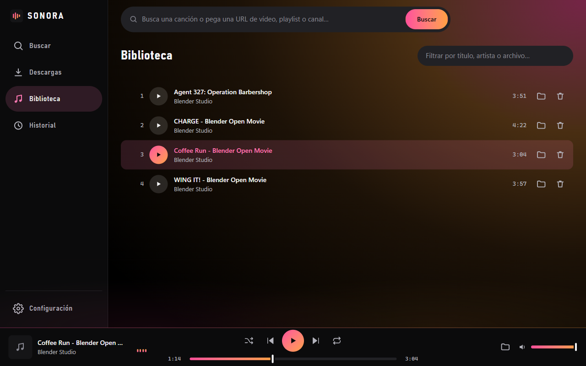

# Uso (desarrollo)

La forma más sencilla en Windows es ejecutar el atajo:

```bash
scripts\iniciar.bat
```

`iniciar.bat` lanza la app con el Python del entorno virtual (`.venv`). La
primera vez lo prepara solo: si no hay `.venv`, o el que hay no funciona (uno
copiado de otro equipo nunca funciona: guarda la ruta absoluta del Python con
el que se creó), lo crea con el Python del sistema e instala las dependencias.
De forma equivalente, desde la raíz del repositorio:

```bash
python -m sonora
```

En ambos casos se abre la **ventana propia** de Sonora (no el navegador). Por
dentro, la app arranca un pequeño servidor Flask en `127.0.0.1` sobre un puerto
libre y abre esa ventana con `pywebview`. Al cerrar la ventana, la app termina
por completo.

## De un vistazo



- **Buscar**: escribe y pulsa Enter (o pega una URL). Cada resultado lleva al
  pie su botón **＋ Añadir** para ponerlo en la cola; con playlists puedes
  añadir **todo** o por **lotes de 100**. Encima de los resultados están los
  [filtros](#filtros-de-búsqueda).
- **Descargas**: elige carpeta de destino y calidad (se recuerdan) y pulsa
  **Descargar todo**. Puedes cancelar la descarga en curso, quitar pendientes
  y reintentar las fallidas.
- **Biblioteca**: pulsa play en cualquier pista; usa aleatorio/repetir y las
  teclas multimedia del sistema. Los vídeos se abren en su propia ventana
  dentro de la app (ver [Ver vídeos](#ver-vídeos)).
- **Historial**: consulta lo descargado anteriormente.

## Color de la interfaz

Sonora es negra, con un único acento en degradado. Se elige en
**Configuración** (abajo, en la barra lateral), dentro de *Apariencia*: hay una
opción por cada uno, el cambio es inmediato y se recuerda para la próxima vez.

| Tema           | Degradado                       |
| -------------- | ------------------------------- |
| **Ocaso**      | rosa a naranja (el de fábrica)  |
| **Cobre**      | naranja a oro                   |
| **Duna**       | arena a oro viejo               |
| **Agave**      | lima a verde menta              |
| **Turquesa**   | turquesa a menta                |
| **Oasis**      | azul a cian                     |
| **Crepúsculo** | violeta (`#A238FF`) a azul añil |
| **Buganvilla** | violeta (`#A238FF`) a magenta   |
| **Luna**       | blanco a gris azulado           |

El degradado se usa con cuentagotas —el botón principal, lo que está sonando,
las barras de progreso— y en la línea que corona la barra de reproducción, que
se ilumina mientras suena algo. Para que la app no se vea tan negra, el mismo
degradado entra además como un resplandor amplio por la esquina superior
derecha y se va apagando hacia el centro.

## Filtros de búsqueda

Sobre los resultados hay una fila de filtros como los de YouTube. Cambiar
cualquiera repite la búsqueda al momento, y **Quitar filtros** los limpia.

| Filtro              | Opciones                                                |
| ------------------- | ------------------------------------------------------- |
| **Orden**           | Relevancia, Más recientes, Popularidad                  |
| **Fecha de subida** | Hoy, esta semana, este mes, este año                    |
| **Duración**        | Menos de 4 minutos, de 4 a 20, más de 20                |
| **Tipo**            | Vídeos, listas, canales                                 |
| **Características** | En directo, 4K, HD, HDR, subtítulos, Creative Commons, 360°, VR180, 3D |

El **orden** elegido se recuerda para la próxima vez; el resto de filtros solo
duran mientras la app está abierta. Los filtros se aplican a las búsquedas por
texto: una URL pegada se abre tal cual.

**Más recientes** merece una aclaración: YouTube ya no ordena por fecha de
subida (su filtro actual solo ofrece relevancia y popularidad), así que Sonora
pide más resultados de los que enseña y los ordena ella misma por la fecha
aproximada que da YouTube («hace 3 meses»). El resultado es lo más nuevo
*entre lo más relevante*, no lo último subido en todo YouTube. Para acotar de
verdad, combínalo con **Fecha de subida**.

Al elegir **Listas** o **Canales**, cada resultado se abre con su botón (**Ver
la lista**, **Ver sus vídeos**) y desde ahí se añade como cualquier playlist;
**Volver a los resultados** deshace el camino.

Faltan a propósito algunos filtros de YouTube: **Películas** (son de pago),
**Shorts** (YouTube no lo admite por esta vía) y **Ubicación** y **Comprado**
(piden iniciar sesión).

## Directos

Con la característica **En directo** la búsqueda devuelve emisiones que están
en el aire. Su tarjeta lleva el rótulo «En directo» y un único botón, **Ver en
directo**, que las abre en la ventana de vídeo de la app (la misma de la vista
previa: se mueve, se redimensiona y pasa a teatro o a pantalla completa).

Un directo en curso **se ve, pero no se descarga**: yt-dlp lo grabaría desde
ese momento hasta que la emisión terminase, y con una radio de 24 horas eso es
un hueco de la cola ocupado para siempre. Por eso su tarjeta no ofrece
«Añadir», y si aun así llega uno a la cola (por ejemplo dentro de una
playlist) se marca como error al instante con un mensaje que lo explica.

Un directo **ya terminado** es un vídeo como cualquier otro: aparece en las
búsquedas normales con «emitido hace…» junto a su duración, y se puede ver y
descargar. Los que están **programados** y aún no han empezado solo enseñan su
sala de espera.

## Escuchar antes de descargar

Cada resultado de búsqueda tiene al pie un botón ▶: abre el reproductor de
YouTube para decidir si la canción es la que buscabas antes de gastar la
descarga. Con ratón también vale pulsar la miniatura. Desde el pie del
reproductor se añade a la cola directamente.

Se abre en la misma **ventana flotante** que los vídeos de la biblioteca (ver
[Ver vídeos](#ver-vídeos)): se mueve, se redimensiona y pasa a modo teatro o a
pantalla completa igual, y recuerda el mismo sitio y tamaño. Como no bloquea el
resto de la app, puedes seguir mirando resultados o añadir otros a la cola
mientras suena. Se cierra con su botón ✕ o con `Esc`.

Solo suena una cosa a la vez: abrir la vista previa pone en pausa lo que
estuviera sonando de la biblioteca, y reproducir algo de la biblioteca cierra
la vista previa.

Se usa el reproductor incrustado de YouTube (dominio `youtube-nocookie.com`,
que no planta cookies de seguimiento) en lugar de traer el audio por nuestra
cuenta: las URLs de stream van firmadas y caducan, así que un reproductor
propio se rompería solo. Requiere conexión.

La resolución de ese reproductor la decide YouTube según el tamaño de la
ventana, y no admite que se le pida otra desde fuera: en la ventana pequeña
suele quedarse en 480p y sube sola a 1080p o más al agrandarla, en modo teatro
o a pantalla completa. También se puede elegir a mano en su rueda de ajustes.

Hay vídeos que YouTube se niega a reproducir fuera de su web («Este vídeo no
está disponible / Ver en YouTube»), aunque sean públicos y se puedan descargar.
Cuando pasa, la ventana cambia sola a un **reproductor propio**, con pausa y
barra de posición: Sonora pide el vídeo y el audio por separado, en la mejor
resolución disponible, y ffmpeg los une al vuelo sin guardar nada en disco.
Tarda unos segundos en arrancar y en saltar a otro punto. Si ni así se puede
ver —un directo en curso, o falta ffmpeg—, queda el botón **Abrir en YouTube**.

## Ver vídeos

Al reproducir un vídeo de la biblioteca se abre una **ventana flotante** sobre
la app, que se coloca y se dimensiona a mano:

- **Mover**: arrastra su barra de título.
- **Cambiar el tamaño**: tira de cualquier borde o esquina. La ventana conserva
  la proporción del vídeo (también en los verticales).
- **Con teclado**: lleva el foco al botón de agarre (los seis puntos de la
  barra) y usa las flechas para mover, `Mayús` + flechas para el tamaño e
  `Inicio` para devolverla a su esquina.

La ventana nunca tapa la barra de reproducción, y la app **recuerda** dónde la
dejaste, su tamaño y el volumen para la próxima vez.

Además de la ventana flotante hay otros dos modos, en los botones de la barra:

- **Modo teatro**: el vídeo ocupa toda la zona de contenido. También con doble
  clic en la barra de título.
- **Pantalla completa**: también con doble clic sobre el vídeo. Al salir, la
  ventana de la app queda como estaba (maximizada, si lo estaba). En la vista
  previa vale igual el botón de pantalla completa del reproductor de YouTube:
  pulsado con la de la app ya puesta, sale de ella.

Sobre el vídeo aparecen sus controles (posición, play/pausa, silencio, volumen
y velocidad de 0.5× a 2×); se esconden solos mientras se reproduce y vuelven al
mover el ratón. Un clic en el vídeo alterna play/pausa.

El botón de la flecha **oculta** el vídeo sin detenerlo, para seguir solo con
el sonido; el icono de la cámara en la barra de reproducción lo vuelve a
mostrar.

## Una sola ventana

Sonora no se abre dos veces sobre los mismos datos: si ya está abierta, un
segundo arranque trae al frente la ventana que hay y termina. Dos copias a la
vez se pisarían la cola de descargas.

## Descargas en paralelo

Por defecto se descargan **tres canciones a la vez**; se ajusta en
**Descargas → A la vez** (de 1 a 5). Con una playlist grande la diferencia es
notable, porque mientras una pista se convierte a MP3 las otras siguen
bajando. Subirlo mucho no siempre es mejor: YouTube estrangula la conexión
cuando se le piden demasiadas cosas a la vez.

El cambio se aplica a la siguiente tanda; las descargas ya en marcha terminan
lo suyo.

## Reintentos automáticos

Si una descarga falla por algo pasajero —un corte de red, un error del
servidor— se reintenta sola hasta tres veces, esperando un poco más en cada
intento. Los fallos definitivos (vídeo privado, borrado o bloqueado en tu
país) no se reintentan: se marcan como error directamente, para no hacer
esperar al resto de la cola.

Mientras una canción se descarga y se convierte, sus ficheros a medias no
están en la carpeta de música sino en una de trabajo aparte (`temporal/`,
junto a `descargas/`): a la biblioteca solo llega el resultado terminado. Al
cancelar una descarga, o cuando falla del todo, esos restos se borran. Si la
app se cierra a media descarga, al volver a abrirla la canción sigue en la
cola y continúa por donde iba.

Lo que añadas a la cola con una tanda ya en marcha se descarga también, y
con las mismas descargas a la vez que tengas configuradas.

## Aviso de actualización

Al abrir Sonora se comprueba el entorno y, si algo merece tu atención, aparece
un aviso abajo en la barra lateral:

- **Hay una versión nueva de yt-dlp.** Es lo que conviene vigilar: YouTube
  cambia a menudo y un yt-dlp viejo deja de descargar (`HTTP Error 403`). El
  botón **Actualizar ahora** lanza `pip install --upgrade yt-dlp` desde la
  propia app; al terminar hay que **reiniciar Sonora** para que surta efecto.
  Hasta que reinicies no se puede buscar ni descargar (la versión nueva en
  disco y la vieja en memoria no deben mezclarse), y por lo mismo no se
  puede actualizar con descargas en marcha.
- **Tu yt-dlp pasa de 90 días** y no se pudo consultar si hay uno más nuevo
  (sin conexión, por ejemplo).
- **Falta un runtime de JavaScript**, con la orden para instalarlo.

Si no hay nada que decir, el aviso no se muestra. La comprobación consulta
PyPI con un tiempo de espera corto y cachea el resultado seis horas, así que no
retrasa el arranque; sin conexión, la app abre igual y no avisa de nada.

> En la app **empaquetada** (`.exe`) no hay pip: **Actualizar ahora** baja la
> versión nueva de yt-dlp de PyPI (comprobando su huella) a
> `%LOCALAPPDATA%\Sonora\yt-dlp\` y, al reiniciar, Sonora la usa en lugar de la
> que trae dentro. Ver [empaquetado.md](empaquetado.md).

## Atajos de teclado

| Tecla             | Acción                                         |
| ----------------- | ---------------------------------------------- |
| `Espacio`         | Play / pausa                                   |
| `←` / `→`         | Retroceder / avanzar 5 segundos                |
| `M`               | Silenciar o devolver el sonido                 |
| `/`               | Ir al buscador                                 |
| Teclas multimedia | Play, anterior, siguiente                      |
| `F`               | Vídeo: pantalla completa                       |
| `T`               | Vídeo: modo teatro (`Esc` vuelve a la ventana) |
| `↑` / `↓`         | Vídeo: subir / bajar el volumen                |

`↑` y `↓` solo mueven el volumen cuando el vídeo tiene el protagonismo (en
teatro, a pantalla completa o con el foco en su ventana); en el resto de la app
desplazan las listas, como siempre.

La interfaz es navegable por completo con teclado, con foco visible, *live
regions* para lectores de pantalla, contraste AA y respeto de
`prefers-reduced-motion`.

---

Siguiente: [CLI](cli.md) · [Empaquetado](empaquetado.md) · [Arquitectura](arquitectura.md)
